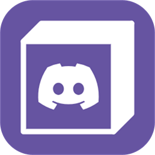

# Discord Presence



[](https://github.com/jumayusiii/minecraft-discord-presence/actions/workflows/build.yml)
[](LICENSE)


A client-side NeoForge mod that shows your Minecraft session as a Discord Rich
Presence. The status stays compact: the server or world name and how many
players are online, without server addresses or raw resource IDs.

## Features

- **Clean status line** — only the server/world name and the online player count.
- **Works in every mode** — main menu, singleplayer, LAN worlds, Realms and
  multiplayer servers.
- **Useful details** — dimension and current game mode, each optional.
- **Optional session timer** — hide the elapsed-time counter completely if you
  prefer a status without a clock.
- **In-game configuration** — open **Mods → Discord Presence → Config** in
  NeoForge; changes apply without restarting the game.
- **No Discord application setup for players** — the released jar carries its
  own application ID.
- **Prism Launcher aware** — shows the Prism Launcher icon when Minecraft is
  started through Prism.
- **Client-side only** — nothing needs to be installed on a server.

## Requirements

| Component | Version |
| --- | --- |
| Minecraft | 26.1.x |
| NeoForge | 26.1.1 or newer in the 26.1 line |
| Discord | Desktop app, running while you play |
| Java | 25 (provided by the Minecraft launcher) |

## Installation

1. Install NeoForge for Minecraft 26.1.x.
2. Download the latest `discordpresence-<version>.jar` from
   [Releases](https://github.com/jumayusiii/minecraft-discord-presence/releases).
   Do not use the `-sources` jar for installation.
3. Put the jar in your Minecraft `mods` folder.
4. Start Minecraft with the NeoForge profile and keep the Discord desktop app
   running.

Use only one version of the mod at a time. Remove older jars before adding a
new one.

## Configuration

The settings are available in-game at **Mods → Discord Presence → Config**, and
are stored in `config/discordpresence-client.toml`.

| Setting | Config key | Default | Description |
| --- | --- | --- | --- |
| Enable Discord presence | `enabled` | `true` | Turns the presence on or off. |
| Show world/server name | `showWorldName` | `true` | Shows the world or server name in the state line. |
| Show player count | `showPlayerCount` | `true` | Shows how many players are online. |
| Show dimension | `showDimension` | `true` | Adds Overworld, the Nether or the End to the large image text. |
| Show game mode | `showGameMode` | `true` | Shows Survival, Creative, Adventure or Spectator. |
| Show session timer | `showSessionTime` | `true` | Shows or hides the elapsed-time counter. |
| Update interval (seconds) | `updateIntervalSeconds` | `5` | Minimum delay between presence updates (4–120). |
| Large image | `largeImage` | Minecraft logo URL | Image URL or uploaded Discord asset key. |
| Small image | `smallImage` | Prism Launcher logo URL | Image used when Prism Launcher is detected. |

## Discord application ID

Discord Rich Presence requires a registered Discord application, but it is not a
player-facing setting. Official jars contain an application ID injected at build
time, so players can install the mod and use it immediately.

The source tree intentionally contains only a placeholder. To build a rebranded
jar under your own Discord application:

```bash
./gradlew build -PdiscordApplicationId=123456789012345678
```

or set `DISCORD_APPLICATION_ID` in the environment. The value must be numeric.
If no ID is supplied, the mod still compiles, but the presence stays hidden and
the log explains why.

For a fork, create a Discord application, upload the large and small Rich
Presence assets you want, and use its application ID for your builds. Never
commit an application ID to `gradle.properties`; keep it in the build command,
your local environment, or the `DISCORD_APPLICATION_ID` repository variable used
by the release workflow.

## Building from source

You need JDK 25. Gradle can provision it automatically through the Foojay
toolchain resolver.

```bash
# Linux / macOS
./gradlew build

# Windows
gradlew.bat build
```

The mod jar is written to `build/libs/discordpresence-1.0.6.jar`; a sources jar
is produced next to it. To launch a development client:

```bash
./gradlew runClient
```

The first build downloads Minecraft and NeoForge, so it can take several
minutes.

### Release builds on GitHub

The `Release` workflow runs when a tag such as `v1.0.6` is pushed. Before
creating the tag, add the repository variable `DISCORD_APPLICATION_ID` under
**Settings → Secrets and variables → Actions → Variables**. The workflow refuses
to publish a release without it, so an official jar always has a working
presence.

## Distribution

This repository is the public source for the mod and can be linked as the
project source on CurseForge. Use the `discordpresence-<version>.jar` asset from
the latest GitHub Release as the downloadable mod; the `-sources` jar is only a
source reference.

## Privacy

The mod talks only to the Discord desktop client over its local IPC socket. It
does not send data to a third-party server and has no telemetry. Discord itself
receives the presence you choose to show; the server name and player count are
therefore visible according to your Discord privacy settings.

## Project layout

```text
src/main/java/dev/discordpresence/   Mod entry point, config and client hooks
src/main/java/dev/discordpresence/ipc/  Discord IPC framing and transports
src/main/java/dev/discordpresence/rpc/  Presence model and background worker
src/main/resources/                  Language file, logo and build-time ID template
src/main/templates/                  Expanded NeoForge metadata
```

## License

MIT — see [LICENSE](LICENSE). Copyright (c) 2026 Jumayusi.

The build scaffolding is based on the NeoForge MDK; see
[THIRD_PARTY_NOTICES.md](THIRD_PARTY_NOTICES.md).

Discord Presence is not affiliated with Discord Inc., Mojang Studios or
Microsoft.
